# How to read the panel

TrustPass protects a quantum circuit from the compiler you hand it to: before the circuit leaves your machine it is *locked* (every rotation angle is replaced by a secret key symbol), and what the compiler returns is unlocked and checked. The checks ask two questions: is it still the same circuit for every input (formal equivalence, MQT QCEC), and does it run about as well as a free honest compile would (a fidelity audit on the device's calibration data)? The panel lets you play the untrusted compiler yourself, from honest to malicious, and watch which checks catch it.

All screenshots below come from the static site (`web/snapshot.json`, Grover on FakeBrisbane, transpiler seed 7) at 1440 px wide, except the "Run on real IBM hardware" unit, which only appears on `python server.py --allow-ibm`. Every number in this guide is read off those screenshots or the data files behind them.

---

## Header

Top-left is the name and model line. Top-right is the provenance of the run on screen: `FakeBrisbane · 127q · seed 7 · run 005` means a noisy model of IBM's 127-qubit Brisbane device, transpiler seed 7, and the fifth run this page has shown. On the static site a small "Turn SOURCE to try an attack" hint sits under the model line.

**What a judge should notice:** the seed only fixes the transpiler. The lock itself is drawn from OS entropy and is never seeded.

## Pipeline keys

**What it is:** the five stages, left to right: **Lock** → **Untrusted compile** → **Unlock** → **Verify** → **Score**.

**What you can do:** nothing directly; they are indicators. Whenever you turn a control, a yellow light chases along the keys while the run is measured, then settles on **Verify**.

**What it means:**
- *Lock*: your circuit's angles become key symbols and the key stays on your machine.
- *Untrusted compile*: the compiler chosen by SOURCE compiles the locked circuit; it never sees the key.
- *Unlock*: the key is bound back into what came back.
- *Verify*: the three checks (CH1, CH2, CH3) run.
- *Score*: confidentiality and cost figures (shown in "Inspect the circuit").

## SOURCE knob

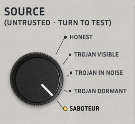

**What it is:** the untrusted compiler. This is the main control: "turn to test".

**What you can do:** click a label, click or drag the knob, use the arrow keys, Home/End, or the mouse wheel over it. The small yellow dot marks the active position.

**What each position means:**
| Position | What the compiler does |
|---|---|
| **Honest** | A normal Qiskit compile (optimization level 3). Should be accepted. |
| **Trojan visible** | Flips one output bit right before measurement. Any output test sees it. |
| **Trojan in noise** | Adds a small phase kick, RZ(0.35), mid-circuit: it changes the answer by less than hardware noise. |
| **Trojan dormant** | Adds a CX between two data qubits at time zero. It does nothing on the all-zeros input, so it only fires on other inputs. |
| **Saboteur** | Keeps the circuit correct but puts it on the device's worst qubits (90th error percentile) and adds self-cancelling gate pairs, so it runs worse. |

**What a judge should notice:** the attacks get progressively harder to see from the output alone. The last two pass the usual "run it and look at the histogram" test.

## CIRCUIT knob

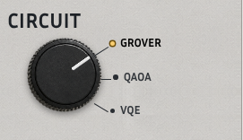

**What it is:** the victim circuit: **Grover** (3 qubits), **QAOA** or **VQE**.

**What you can do:** same handling as SOURCE. Changing it reruns everything, including the detection matrix.

## BACKEND lever

**What it is:** which noisy device model the fidelity audit uses: **Brisbane** (FakeBrisbane, 127 qubits) on the left or **Torino** (FakeTorino) on the right. The active side is the bright label.

**What you can do:** click to flip it. The provenance line in the header changes to match.

## The screen (traces)

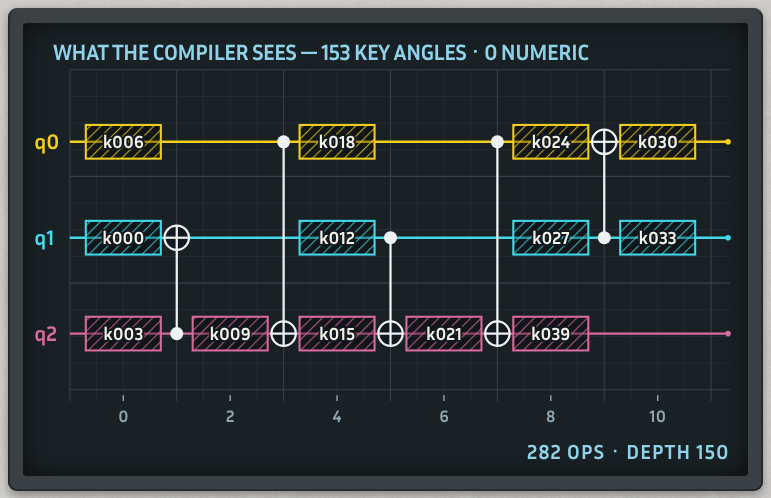

**What it is:** the locked circuit as the compiler receives it, drawn like oscilloscope traces, one coloured wire per qubit (q0 yellow, q1 cyan, q2 pink).

**What each mark means:**
- Hatched boxes labelled `k006`, `k018`, … are keyed blocks. Each one hides three rotation angles behind key symbols. The compiler sees the name, never the value.
- Dots joined to ⊕ are CX gates, the only structure the compiler can see.
- The numbers along the bottom are column indices.
- Title: `153 key angles · 0 numeric` means 153 hidden angles and no angle left in the clear. Footer: `282 ops · depth 150` is the locked circuit's size.

**What you can do:** Shift+wheel (or a horizontal wheel/trackpad swipe) pans through the rest of the circuit.

**What a judge should notice:** "0 numeric". The compiler cannot read a single angle of your circuit.

## CH1 / CH2 / CH3 readouts

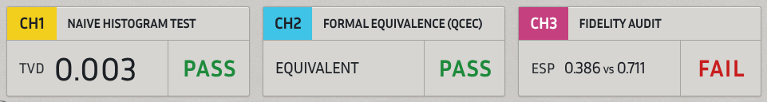

Three channels, one per check, each with a **PASS** (green) or **FAIL** (red) status.

- **CH1 Naive histogram test** (yellow tab): what most people do today. Run the returned circuit on the all-zeros input and compare its histogram with the expected one. The number is the **TVD**; it passes below 0.1. In the screenshot (Saboteur) it reads `TVD 0.003 · PASS`.
- **CH2 Formal equivalence (QCEC)** (cyan tab): a proof that the returned circuit equals yours for *every* input. Shows `EQUIVALENT`, `NOT EQUIVALENT` or `UNVERIFIABLE` (QCEC could not decide in time; that counts as a fail).
- **CH3 Fidelity audit** (pink tab): estimated success probability (**ESP**) of the returned circuit vs an honest compile of the same lock: `ESP 0.386 vs 0.711 · FAIL`. It passes when the ratio is at least 0.9.

**What a judge should notice:** on Saboteur, CH1 and CH2 both pass. Only CH3 sees the attack.

## Verdict lamp and reason line

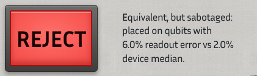

**What it is:** the overall result. A green **ACCEPT** needs CH2 *and* CH3 to pass. Anything else is a red **REJECT**. CH1 is shown for comparison and does not decide the verdict.

**The reason line** says why, in one sentence. The four reasons on Grover/FakeBrisbane:
- Honest: "Equivalent to your circuit and as good as an honest compile. Safe to run."
- Any Trojan: "Not equivalent to your circuit: the compiler changed what it computes."
- Saboteur: "Equivalent, but sabotaged: placed on qubits with 6.0% readout error vs 2.0% device median."

## Detection matrix and its counters

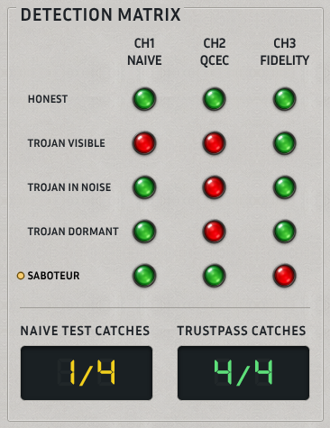

**What it is:** every SOURCE position (rows) against every check (columns CH1 Naive, CH2 QCEC, CH3 Fidelity) for the current circuit and backend. The yellow dot marks the row you are on.

**Colours:** green lamp = passed; red lamp = attack caught (that check failed it). The legend under the matrix says this.

**Counters** (seven-segment displays, out of the 4 attacks):
- **Naive test catches 1/4**: the histogram test only catches Trojan visible.
- **TrustPass catches 4/4**: every attack ends in REJECT.

**What a judge should notice:** the diagonal-ish pattern. CH2 catches all three Trojans, CH3 catches the saboteur, and no single check catches everything. The honest row is all green, so there is no false alarm.

## Bench: CH3 fidelity audit

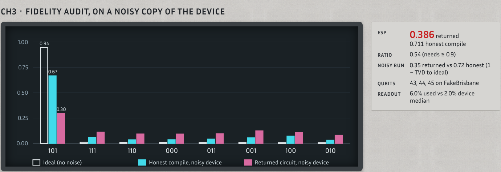

**What it is:** the evidence behind CH3, simulated on a noisy copy of the device. For each output bitstring (`101`, `111`, …) three bars:
- white outline: **Ideal (no noise)**, the right answer (`101` at 0.94 for Grover);
- cyan: **Honest compile, noisy device** (0.67 on `101`);
- pink: **Returned circuit, noisy device** (0.30 on `101` for Saboteur).

**The specs on the right** (Saboteur):
- **ESP** `0.386 returned` (red because it fails) vs `0.711 honest compile`.
- **Ratio** `0.54 (needs ≥ 0.9)`.
- **Noisy run** `0.35 returned vs 0.72 honest (1 − TVD to ideal)`, a full noisy simulation that agrees with the ESP estimate.
- **Qubits** `43, 44, 45 on FakeBrisbane`, the physical qubits the returned circuit uses.
- **Readout** `6.0% used vs 2.0% device median`.

**What a judge should notice:** the saboteur's answer is still "right" (101 is still the tallest pink bar), so a casual look passes it, but its signal is less than half the honest one.

## Bench: Inspect the circuit (three tabs)

| Your circuit | What the compiler sees | What came back |
|---|---|---|
| 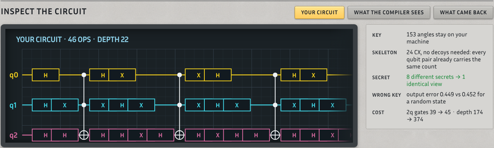 | 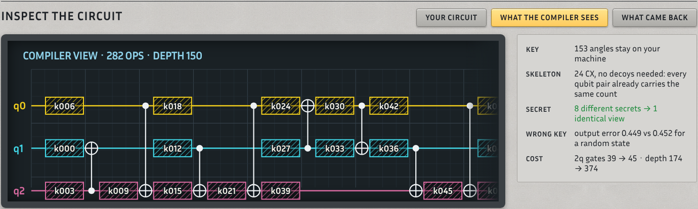 | 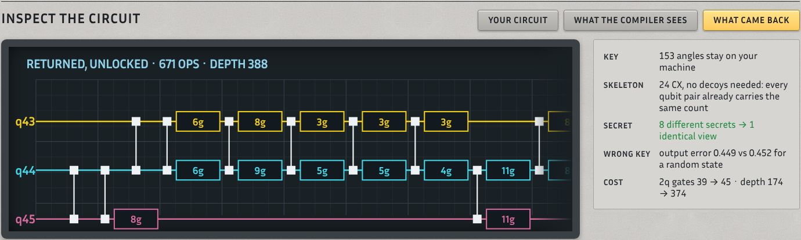 |

**What it is:** the same circuit at three points: **Your circuit** (the original Grover, 46 ops, depth 22), **What the compiler sees** (locked, 282 ops, depth 150), **What came back** (compiled and unlocked, 671 ops, depth 388). Click a tab to switch, and scroll sideways inside the screen for the rest.

**The specs on the right:**
- **Key** `153 angles stay on your machine`.
- **Skeleton** `24 CX, no decoys needed: every qubit pair already carries the same count`. Where a circuit's qubit pairs carry different CX counts, decoys are added and their share is shown here.
- **Secret** `8 different secrets → 1 identical view` (green): all 8 possible Grover targets lock to a view the compiler cannot tell apart.
- **Wrong key** `output error 0.449 vs 0.452 for a random state`: running with a wrong key is about as wrong as knowing nothing.
- **Cost** `2q gates 39 → 45 · depth 174 → 374`, the price of locking after compilation.

## Bench: Plant a Trojan

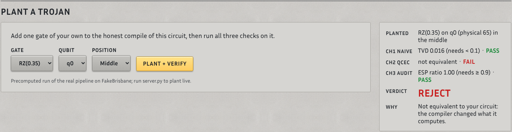

**What it is:** your own attack. Pick a **Gate** (X, Z, S, RZ(0.35), CX), a **Qubit** and a **Position** (Start, Middle, End), then press **Plant + verify**. The gate is added to the honest compile of the current circuit and all three checks run on it.

**The result** (defaults: RZ(0.35) on q0, middle):
- **Planted** `RZ(0.35) on q0 (physical 65) in the middle`
- **CH1 Naive** `TVD 0.016 (needs < 0.1) · PASS`
- **CH2 QCEC** `not equivalent · FAIL`
- **CH3 Audit** `ESP ratio 1.00 (needs ≥ 0.9) · PASS`
- **Verdict** `REJECT`, **Why** "Not equivalent to your circuit: the compiler changed what it computes."

On the static site these are precomputed runs on FakeBrisbane (the note under the button says so). With `python server.py` they run live on the selected backend.

**What a judge should notice:** a gate small enough to slip past the histogram test and leave fidelity untouched is still caught by the equivalence proof.

## Bench: Measured on real IBM hardware

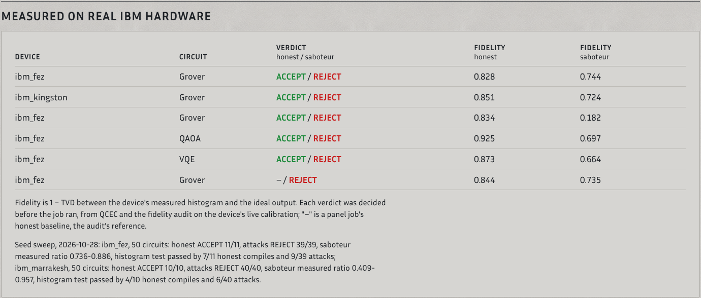

**What it is:** recorded jobs on real IBM devices (from `web/hardware.json`). Each row: device, circuit, the verdict for the honest and the saboteur compile, and their measured **fidelity** (1 − TVD between the device's histogram and the ideal output). Verdicts were decided *before* the job ran, from QCEC and the audit on that day's calibration. A "–" marks a panel job's honest baseline, which is the audit's reference and has no verdict of its own.

The note under the table summarises the 2026-10-28 seed sweep: on ibm_fez, honest ACCEPT 11/11 and attacks REJECT 39/39; on ibm_marrakesh, honest ACCEPT 10/10 and attacks REJECT 40/40. The same line reports the naive histogram test on the real histograms: it passed 7/11 and 4/10 honest compiles (false alarms) and let 9/39 and 6/40 attacks through.

**What a judge should notice:** the saboteur's measured fidelity is below the honest one in every row (for example 0.828 vs 0.744 on ibm_fez), so the pre-run verdict held on real hardware.

## Bench: Run on real IBM hardware (live server only)

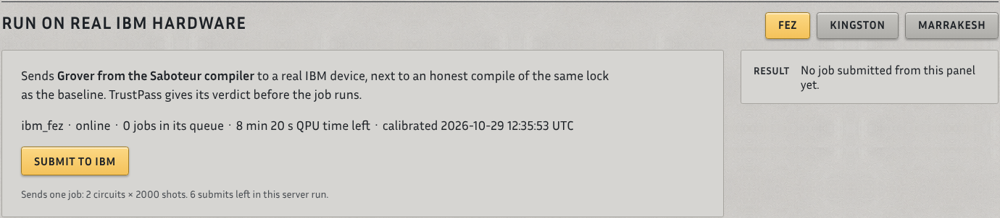

**What it is:** a button that sends the current circuit, as compiled by the current SOURCE (or with your planted gate), to a real IBM device, alongside an honest compile of the same lock as the baseline. It only appears when you start `python server.py --allow-ibm` with a saved IBM Quantum account; it is hidden on the static site.

**What you can do:** pick **Fez**, **Kingston** or **Marrakesh**. The status line shows the device's state, queue, QPU time left and calibration time (at capture: `ibm_fez · online · 0 jobs in its queue · 8 min 20 s QPU time left`). **Submit to IBM** asks for confirmation, then sends one job of 2 circuits × 2000 shots. The verdict is shown immediately, before the job runs; measured results fill in when it finishes. A server run allows 6 submits, and the button locks when QPU time drops under 2 minutes.

## Bench: Acquisition ledger

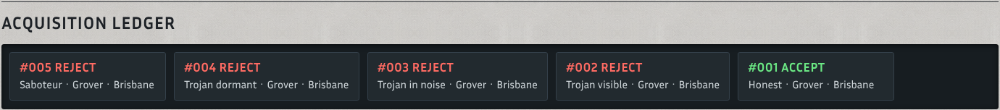

**What it is:** a tape of the runs this browser has made, newest first: run number, verdict (green ACCEPT, red REJECT), SOURCE, circuit and backend. The screenshot shows the five SOURCE positions in order: #001 ACCEPT Honest, then #002-#005 REJECT. It is stored in your browser only and keeps the last 30.

## Bench: Rating plate

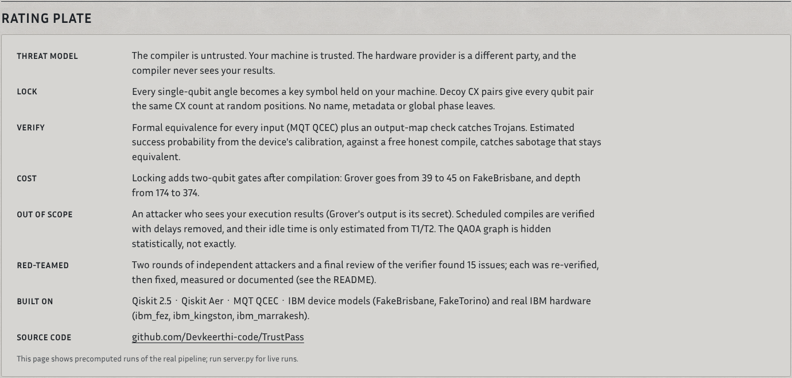

**What it is:** the instrument's spec sheet: threat model, how the lock works, what Verify checks, the cost of locking for the current circuit, what is **out of scope** (an attacker who sees your results; scheduled-compile idle time is only estimated; the QAOA graph is hidden statistically, not exactly), the red-team history, and what it is built on.

**What a judge should notice:** the "Out of scope" line. The panel states its own limits.

---

## The five SOURCE positions

| | |
|---|---|
| **Honest:** all three checks pass, ESP 0.711 vs 0.711, **ACCEPT**. | 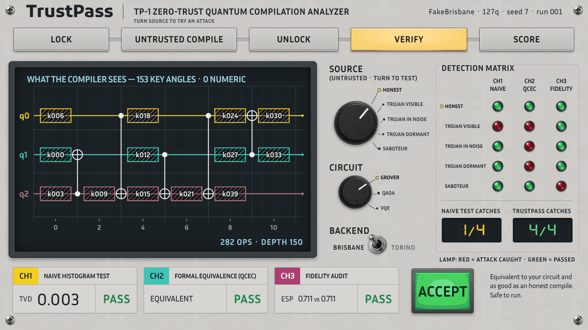 |
| **Trojan visible:** CH1 FAIL (TVD 0.940), CH2 NOT EQUIVALENT, CH3 PASS. **REJECT**. |  |
| **Trojan in noise:** CH1 PASS (TVD 0.016), CH2 NOT EQUIVALENT, CH3 PASS. **REJECT**. | 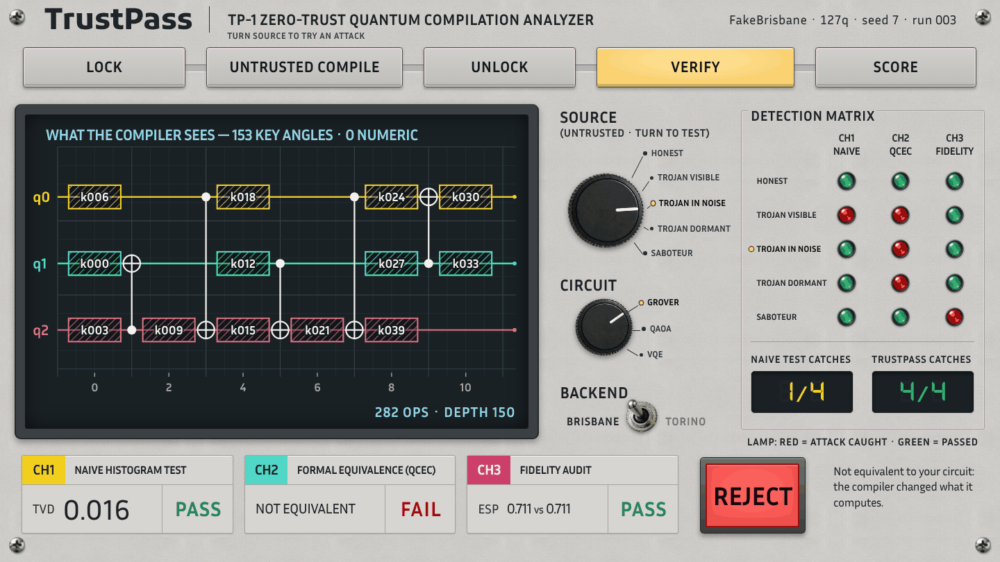 |
| **Trojan dormant:** CH1 PASS (TVD 0.003), CH2 NOT EQUIVALENT, CH3 PASS (0.706 vs 0.711). **REJECT**. | 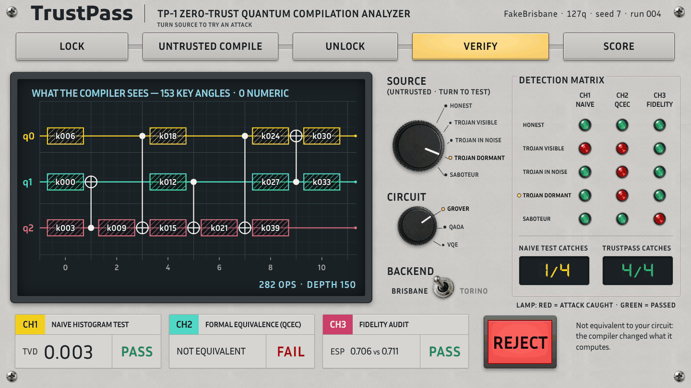 |
| **Saboteur:** CH1 PASS (TVD 0.003), CH2 EQUIVALENT, CH3 FAIL (0.386 vs 0.711). **REJECT**. |  |

## Walk-through

1. **Honest.** Turn SOURCE to *Honest*. All three readouts pass, the lamp is green **ACCEPT**, and the matrix's honest row is all green. This is the baseline: TrustPass does not cry wolf.
2. **Trojan dormant.** Turn to *Trojan dormant*. CH1 still says PASS with TVD 0.003, identical to the honest compile, because the hidden CX does nothing on the all-zeros test input. CH2 proves the circuit is NOT EQUIVALENT, and the lamp goes red. The usual histogram check would have shipped this.
3. **Saboteur.** Turn to *Saboteur*. Now CH2 also passes (the circuit really is correct), but CH3 fails: ESP 0.386 vs 0.711, ratio 0.54. The reason line names the cause: qubits with 6.0% readout error vs a 2.0% median. On the bench, the pink bars show the answer drowning in noise.
4. **Plant a Trojan.** On the bench, plant RZ(0.35) on q0 in the middle and press *Plant + verify*. CH1 passes (TVD 0.016) and CH3 passes (ratio 1.00), but QCEC says not equivalent: REJECT. Try other gates and positions to hunt for one that gets through.
5. **Real IBM hardware.** Read *Measured on real IBM hardware*: on every row the saboteur's real-device fidelity is lower than the honest one, and every verdict was given before the job ran. With `python server.py --allow-ibm` and an IBM account, *Run on real IBM hardware* sends the current setup to Fez, Kingston or Marrakesh yourself.

## Glossary

- **TVD (total variation distance):** how different two output histograms are, from 0 (identical) to 1 (no overlap). CH1 passes below 0.1; "fidelity" on the hardware table is 1 − TVD to the ideal output.
- **QCEC:** MQT's Quantum Circuit Equivalence Checker. It proves (or refutes) that two circuits do the same thing on every input, up to global phase. That is CH2.
- **ESP (estimated success probability):** the chance a circuit runs without any error, multiplied out from the device's calibrated gate and readout error rates on the qubits it uses.
- **ESP ratio:** returned circuit's ESP ÷ an honest compile's ESP of the same lock. CH3 passes at 0.9 or above.
- **Key angle:** one hidden rotation angle. The compiler sees a symbol like `k006`; the value stays on your machine and is bound in only after compilation.
- **Decoy:** a pair of CX gates that cancel out, inserted so every qubit pair carries the same CX count and the gate pattern doesn't reveal which qubits really interact. Grover needs none; QAOA needs 1 pair and VQE 3.
- **Lock:** rewriting the circuit so that only its CX skeleton is visible and every single-qubit angle is a key angle. Unlocking means putting the key values back.
- **Hybrid:** short for a hybrid quantum-classical algorithm, where a classical optimiser tunes a quantum circuit's angles. QAOA and VQE on the CIRCUIT knob are of this kind, and locking hides exactly those angles. (The panel itself does not use the word.)
- **Saboteur:** a compiler that returns a correct (equivalent) circuit that is deliberately placed and padded to run badly. Only the fidelity audit catches it.
- **Dormant Trojan:** a malicious change that does nothing on the test input (all zeros) and only changes the result on other inputs, so a histogram test cannot see it. The equivalence check covers every input, so it does.
